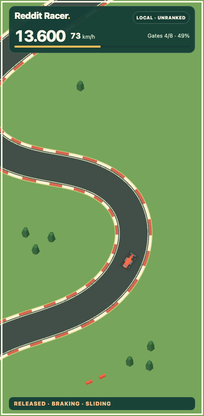
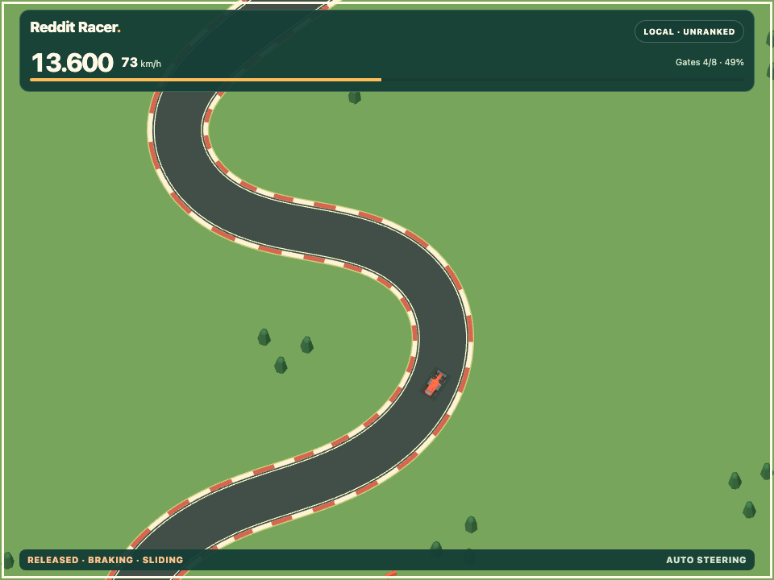

# Kenney assets and visual loading

The supplied `assets/3d_models.zip` was inspected before selecting game art. It contains six kits with 595 GLB models plus alternate formats and previews, approximately 27 MiB compressed and 73 MiB uncompressed. The archive remains source material; browsers receive only the seven selected files below.

## Roads and selected art

Road meshes, kerbs, grid and markings are generated from the authoritative centreline. This supports smooth procedural hairpins, sweepers and decreasing-radius corners without constraining simulation to fixed road tiles. The [City Kit Roads](https://kenney.nl/assets/city-kit-roads) and [3D Road Tiles](https://kenney.nl/assets/3d-road-tiles) packs were evaluated as useful visual references and prop sources; fixed tile radii would restrict the generator.

The orange Car Kit racer provides strong foreground contrast with dark tyres and one shared palette material. Sparse Racing Kit tree groves, fence runs and start furniture give the circuit a consistent miniature scale.

All archive paths below begin with `3d_models/`. Browser files live under `src/client/assets/kenney/`.

| Browser path                       | Original archive path                                        |   Bytes | Triangles / material primitives |
| ---------------------------------- | ------------------------------------------------------------ | ------: | ------------------------------: |
| `car-kit/race.glb`                 | `kenney_car-kit/Models/GLB format/race.glb`                  | 167,272 |                       1,952 / 5 |
| `car-kit/Textures/colormap.png`    | `kenney_car-kit/Models/GLB format/Textures/colormap.png`     |  12,371 |               512 × 512 palette |
| `racing-kit/treeSmall.glb`         | `kenney_racing-kit/Models/GLTF format/treeSmall.glb`         |   6,960 |                          72 / 2 |
| `racing-kit/barrierRed.glb`        | `kenney_racing-kit/Models/GLTF format/barrierRed.glb`        |   3,244 |                          28 / 1 |
| `racing-kit/barrierWhite.glb`      | `kenney_racing-kit/Models/GLTF format/barrierWhite.glb`      |   3,252 |                          28 / 1 |
| `racing-kit/pylon.glb`             | `kenney_racing-kit/Models/GLTF format/pylon.glb`             |   8,088 |                         108 / 1 |
| `racing-kit/flagCheckersSmall.glb` | `kenney_racing-kit/Models/GLTF format/flagCheckersSmall.glb` |  10,604 |                         132 / 4 |

The selected payload totals **211,791 bytes, 2,320 template triangles and 14 material primitives** before instancing. [The extraction manifest](../src/client/assets/kenney/manifest.json) records the ZIP SHA-256, exact full archive paths, individual hashes, measurements and wheel facts. Payloads are unmodified. Other cars, buildings, previews, duplicate formats and archive metadata are excluded.

## Loader and materials

`scene-assets.ts` loads local GLBs only in the expanded game. Car and prop promises are separately cached, and every model gets an independent LoadingManager and ten-second deadline. Missing models or textures keep the immediate primitive fallback; optional props can fall back independently. Loading never delays the race or changes ranked eligibility. Completed art is installed only between attempts.

The Car Kit GLB refers to `Textures/colormap.png`; its exact resolved request is remapped to the separately imported Vite palette URL. The URL remap does not depend on filenames being preserved and avoids remote requests or ambiguous matching of other kits' palettes. The pinned Devvit Vite plugin currently emits stable asset names (`assetFileNames: '[name][extname]'`), so this production build has six named GLBs and `colormap.png`, rather than hashed names. Small GLBs use Vite's `no-inline` asset option. The checker flag's 128 × 128 texture is embedded.

The selected models load as **lit MeshStandardMaterial**. The car keeps its original palette; scenery uses owned material clones to give foliage, bark and red/cream barriers a clearer shared theme while preserving roughness and maps. The Racing GLBs declare `KHR_materials_unlit` in `extensionsUsed`, but attach it to zero actual materials. An earlier inventory inferred unlit shading from that declaration; the actual material bindings and Three.js loader inspection correct that inference. Do not convert based on the top-level declaration alone.

The cache owns imported geometry, materials and textures for scene lifetime. Car clones and instanced scenery borrow those resources. The scenery owns its small set of recoloured material clones and disposes those separately without freeing borrowed textures. Retry and continuous laps reuse GPU data. Changing track or Daily/Practice mode disposes the scene and its cache, then mounts one replacement; whole-scene disposal releases owned imports once. All native scene listeners share an abortable lifetime, and mode changes stop the old frame callback and daily controllers. Three.js LoadingManager aborts supported GLB/image fetches when a deadline or teardown occurs; late unabortable results are ignored and disposed.

## Grounding and visual state

The Car Kit model is Y-up with +Z forward, four named wheels and no animation clips. It is uniformly scaled to 3.8 m long and grounded with its normalized wheel minimum at visual Y=0.045, above asphalt Y=0.03. Wheel spin follows authoritative distance. Bounded body-only pitch and roll leave the axles grounded; rear lamps and unspun rear tread contacts use local -Z. The imported source remains immutable.

Racing prop offsets and barrier corner origins are normalized from actual bounds. Their bases sit at visual Y=-0.045; the flat grass field uses a matching clear color. Deterministic clustered placement is capped at 64 instances and checks every closed-loop road segment, including variable width. Props clear the road half-width, the authoritative 8 m recovery margin, the largest car footprint and each full prop footprint. Rejected positions remain empty. Repeated primitives use instancing rather than individual draw calls.

Visual meshes never define road bounds, collision, checkpoints, grip or scores. The canonical track and shared fixed-step simulation remain authoritative. The lightweight splash imports neither Three.js nor these assets.

## Provenance and licence

Kenney's [Car Kit](https://kenney.nl/assets/car-kit) and [Racing Kit](https://kenney.nl/assets/racing-kit) use [Creative Commons CC0 1.0 Universal](https://creativecommons.org/publicdomain/zero/1.0/). [Kenney support](https://kenney.nl/support) describes optional attribution. The supplied ZIP contains no licence/readme file, so the selected directory includes a [source and CC0 notice](../src/client/assets/kenney/NOTICE.md). No Kenney logo is used. Asset licensing is separate from the repository's source-code licence.

## Rendered checks

The generated `showcase-3` browser run uses real keyboard holds/releases, completes all gates at exactly 3,215 shared-simulation ticks (26.792 seconds), then retries. These captures show the actual local renderer; they are unranked automated runs, not concept art or physical-phone observations. The earlier [generated mobile still](screenshots/generated-driving-mobile.png) remains available for comparison.

The orthographic camera keeps fixed north at 15 degrees from vertical. Its fit includes every canonical shoulder vertex from 5 m behind to 35 m ahead and the actual oriented car, using measured HUD/footer space. Centre follow is damped, zoom-in eases and zoom-out immediately preserves the required road/car fit. Idle overview and race chase do not affect fixed-step state. Numerical tests cover closed-loop wrap, intervening hairpins, off-road poses, damping, tiny/zero viewports and synchronous resize; browser checks inspect actual normal/mobile layouts and late-wrapping daily details.

## Drawing cost and flat field

The first #21 CI run passed all mobile checks but timed out eight desktop driving cases before their finishes. A controlled comparison of the same first ten scored seconds at `e01890c5` and baseline `b1746df` isolated drawing cost: current desktop wall cost was 4.388s versus 3.011s, with 625 RAF callbacks, 625 clears, no HUD ResizeObserver callbacks during scoring and only 2.56ms of measured layout/style work. This uses virtual-clock frame execution, not presented FPS.

A second local comparison waited for queued graphics work at each stage boundary. The unchanged current scene took 3.677s for the scored segment; a lit Lambert experiment took 3.644s, giving no useful reason to change the imported PBR materials. Replacing only the uniformly lit, untextured grass plane with its measured `#77a55b` background took 3.095s (15.8% less scored wall cost). Startup plus countdown plus scoring fell about 20%. It removes one redundant full-screen pass per RAF while preserving the road, car, props and independent contact-shadow quad. Outside the labelled diagnostic caption, 43 of 648,000 comparison pixels changed (0.0066%). The production fix uses that matching flat field.

These bounded observations used Apple M5 Max / Darwin arm64 / 18 logical CPUs, Node 24.22.2, Chromium 158.0.8127.18 with ANGLE Vulkan SwiftShader, 960×720 at DPR1. They do not predict Linux CI or physical-phone FPS. The original materials, geometry, assets and racing rules remain unchanged. The generated-lap test now retains actual browser/WebGL metadata alongside existing screenshots for future CI diagnosis. Raw local reports and reproducer are under `/tmp/reddit-racer-render-profile40/`; full regression checks and fresh Linux CI remain the delivery gate.
