# Circuit minimap

Implements [#59](https://github.com/kickflip-games/reddit_racer/issues/59). A quiet circuit outline appears in the bottom-right only while racing. It uses the existing muted paper/ink palette, a warm completed segment, a white player dot and a small start/finish tick. There is no panel or extra visible label.

## Geometry and progress

`src/client/circuit-minimap.ts` projects the actual stored canonical centreline into a padded 160 × 160 SVG viewBox. It preserves aspect ratio and fixed world orientation (positive X right, positive Z down), including the closing segment. Coordinates and the complete path are built once per loaded track. Elevation does not distort the top-down outline.

Each update reads the existing shared simulation's current distance. Practice subtracts the driver's authoritative completed-lap count; ranked distance clamps at the finish instead of wrapping. A binary search in stored sample `s` locates the current segment, interpolates the dot, and maps that stored arc-length position onto the SVG's cumulative drawn length. Crossing/overlapping positions therefore keep different completed-route values instead of relying on distance to the finish. The loop seam resets cleanly on each continuous practice lap.

The outline never rotates with the car or camera. No new Three.js scene, camera, context, render pass, simulation step, timer, animation loop, dependency, endpoint or gameplay request is introduced. Only the dot's two coordinates and progress dash offset can change each frame, with quantised values and redundant attribute writes suppressed. The SVG node count is constant; disposal hides/clears progress and reuses the existing nodes on track changes.

## Layout, states and accessibility

- Portrait: 100–120 CSS px; desktop: 140 px; short landscape layouts: 88 px. CSS `env()` safe-area insets keep the map away from screen edges.
- Settings stays at the top-right. Opening its modal temporarily hides the map. Start, countdown, finish, interrupted and unusable-viewport states do not display active progress.
- The whole overlay, including SVG children, uses `pointer-events: none`. Native mouse and touch input over the map reaches the existing driving canvas and its pointer capture.
- A screen-reader progressbar exposes the current lap and integer completion percentage. A separate polite live region announces ten-percent boundaries and lap changes, rather than narrating every frame. Visible percentage text is omitted to keep the HUD minimal.

## Actual screenshot comparisons

Before is clean main `f7d97ec74734ce6391c1d9f67c13dac51bda16fd`. After uses application source `d74bb28` (later commits add tests/evidence). Both run through the normal UI with native Space input, the same virtual-clock schedule and the same viewport. No camera, simulation or HUD overrides are used. These are scripted browser captures, not human or physical-phone playtesting.

### Desktop

| Before                                                                   | After                                                                  |
| ------------------------------------------------------------------------ | ---------------------------------------------------------------------- |
| 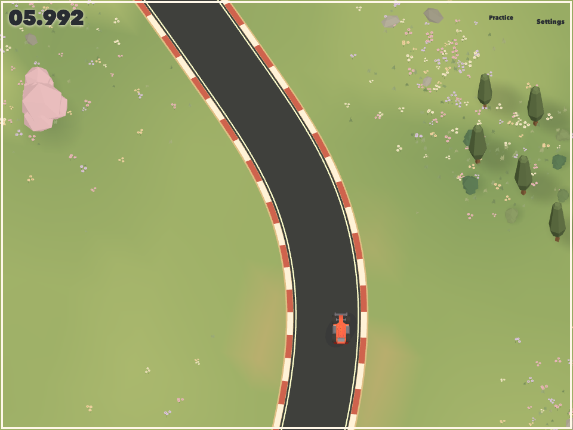 | 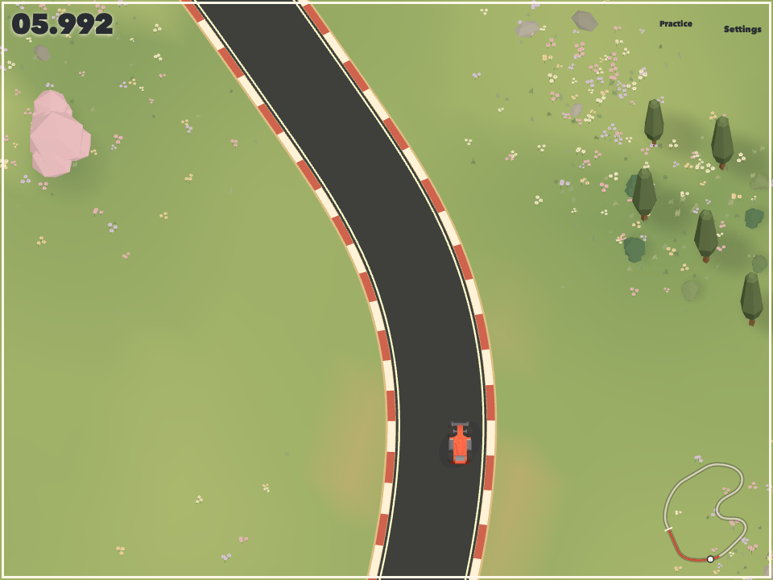 |

### Portrait

| Before                                                                     | After                                                                    |
| -------------------------------------------------------------------------- | ------------------------------------------------------------------------ |
| 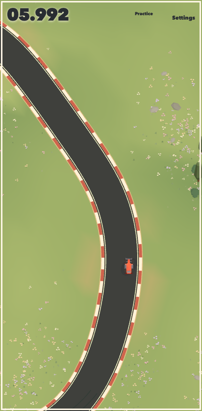 | 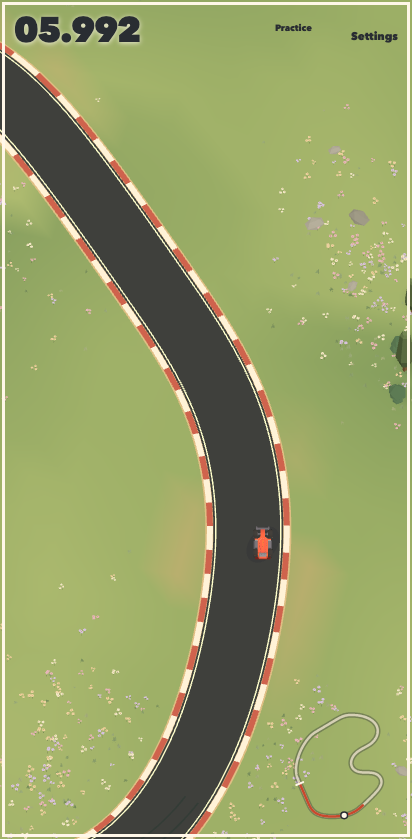 |

### Six canonical procedural courses

Cropped maps retain their native pixel sizes. Each seed also has complete before/after desktop and portrait images linked below; the last two use the elevated generator.

| Seed                 | Desktop map                                                   | Portrait map                                                   | Full captures                                                                                                                                                                                                                                                                       |
| -------------------- | ------------------------------------------------------------- | -------------------------------------------------------------- | ----------------------------------------------------------------------------------------------------------------------------------------------------------------------------------------------------------------------------------------------------------------------------------- |
| minimap-0            | 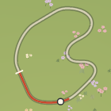 | 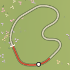 | [Desktop before](evidence/circuit-minimap/before/minimap-0-desktop.png) · [after](evidence/circuit-minimap/after/minimap-0-desktop.png); [portrait before](evidence/circuit-minimap/before/minimap-0-portrait.png) · [after](evidence/circuit-minimap/after/minimap-0-portrait.png) |
| minimap-1            | 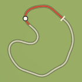 | 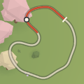 | [Desktop before](evidence/circuit-minimap/before/minimap-1-desktop.png) · [after](evidence/circuit-minimap/after/minimap-1-desktop.png); [portrait before](evidence/circuit-minimap/before/minimap-1-portrait.png) · [after](evidence/circuit-minimap/after/minimap-1-portrait.png) |
| minimap-2            | 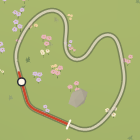 | 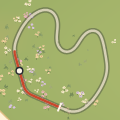 | [Desktop before](evidence/circuit-minimap/before/minimap-2-desktop.png) · [after](evidence/circuit-minimap/after/minimap-2-desktop.png); [portrait before](evidence/circuit-minimap/before/minimap-2-portrait.png) · [after](evidence/circuit-minimap/after/minimap-2-portrait.png) |
| minimap-3            | 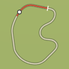 | 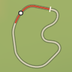 | [Desktop before](evidence/circuit-minimap/before/minimap-3-desktop.png) · [after](evidence/circuit-minimap/after/minimap-3-desktop.png); [portrait before](evidence/circuit-minimap/before/minimap-3-portrait.png) · [after](evidence/circuit-minimap/after/minimap-3-portrait.png) |
| minimap-4 (elevated) | 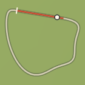 | 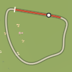 | [Desktop before](evidence/circuit-minimap/before/minimap-4-desktop.png) · [after](evidence/circuit-minimap/after/minimap-4-desktop.png); [portrait before](evidence/circuit-minimap/before/minimap-4-portrait.png) · [after](evidence/circuit-minimap/after/minimap-4-portrait.png) |
| minimap-5 (elevated) | 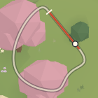 | 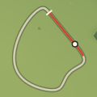 | [Desktop before](evidence/circuit-minimap/before/minimap-5-desktop.png) · [after](evidence/circuit-minimap/after/minimap-5-desktop.png); [portrait before](evidence/circuit-minimap/before/minimap-5-portrait.png) · [after](evidence/circuit-minimap/after/minimap-5-portrait.png) |

### Hairpin and compact portrait

| Desktop hairpin                                         | Portrait hairpin                                         | 320 × 568                                              |
| ------------------------------------------------------- | -------------------------------------------------------- | ------------------------------------------------------ |
| 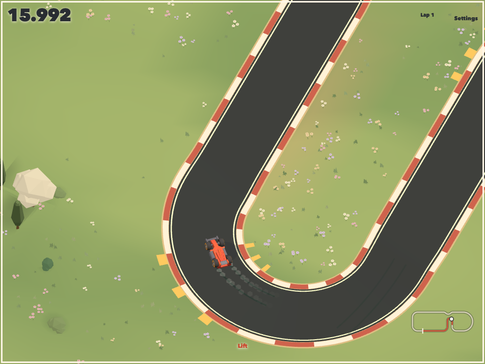 | 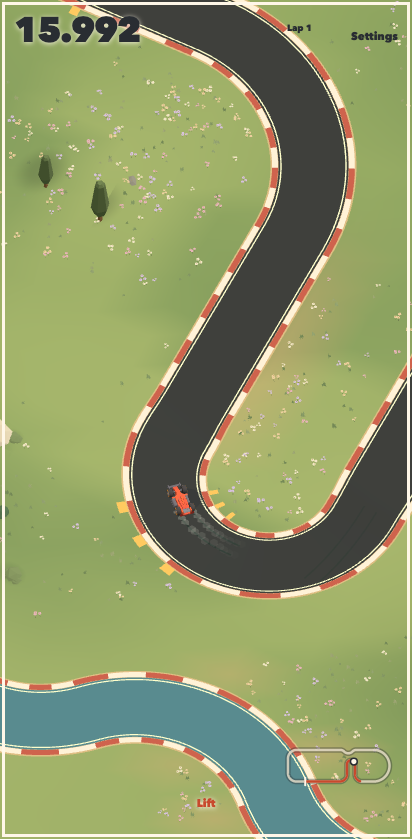 | 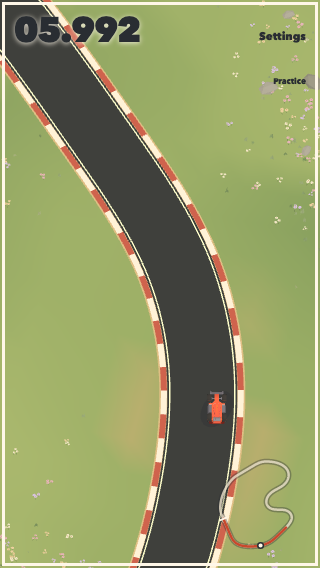 |

Corresponding [hairpin desktop baseline](evidence/circuit-minimap/before/hairpin-desktop.png), [portrait baseline](evidence/circuit-minimap/before/hairpin-portrait.png), and [320 px baseline](evidence/circuit-minimap/before/small-portrait.png) are retained too.

**All 15 pairs have zero changed RGB pixels outside the minimap area** (plus its one-pixel comparison border): 7,184,096 unchanged pixels in total. Observed simulation progress, Three draw calls/triangles and the single game canvas also match exactly. Both sets record zero backend requests and zero browser errors. These are rendering/counter comparisons, not a physical-device frame-rate benchmark.

The [capture manifests](evidence/circuit-minimap/after/manifest.json) record input schedule, observed progress, render counts, canvas count, backend requests, map bounds and runtime errors. [Pixel/counter comparison](evidence/circuit-minimap/comparison.json) excludes only the minimap rectangle plus a one-pixel border when measuring changes outside the overlay. Source images are not edited.

Reproduce with `node scripts/capture-minimap.mjs NEW_DIRECTORY`, using `CAPTURE_URL` for the separately served baseline, then `node scripts/compare-minimap-captures.mjs BEFORE AFTER NEW_REPORT.json`.

## Validation

- Six new unit cases cover six generated seeds plus elevated and hairpin layouts, orientation/aspect ratio, interpolation and closing seam, continuous laps versus ranked finish, crossing coordinates, degenerate bounds, invalid input, and unchanged canonical track/simulation/replay data.
- Actual desktop/portrait browser cases check all six course outlines and dot/stroke positions against simulation progress, active/countdown visibility, resize and simulated safe areas, native input through the map, Settings, interruption clearing, immutable outline attributes, and in-place regeneration with a stable SVG node count.
- Existing full-lap, ranked replay, and continuous-practice tests also assert minimap visibility, hidden finish state and the full-to-empty highlight reset at the real lap boundary.
- `npm run check` passes: 349 unit tests, formatting, types, lint, 200 classic courses and production build. The separate 200-course elevated validation also passes.
- Final browser/CI results are recorded on the pull request before merge. No manual screen-reader session or physical-phone benchmark is claimed by these captures.

`src/shared`, `src/server`, track/replay versions, canonical hashes, driving controls and leaderboard transport are unchanged.
