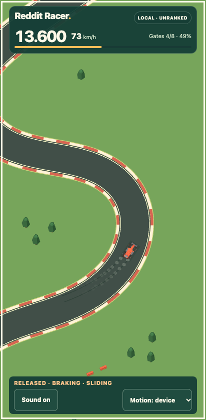
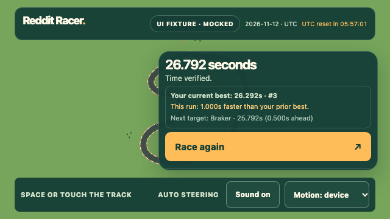

# Pooled driving effects

The expanded scene owns one `createDrivingVfx(track)` instance. Call `update` after updating the car, reading `carVisual.getRearContacts(leftOut, rightOut)` and updating the camera. Rear contacts already represent world-space ground points; they do not need another wheel-radius offset.

The frame supplies a read-only authoritative simulation state and race phase, accelerator state, acceleration, the two contacts, bounded visual elapsed time, CSS pixels per metre and effective reduced motion. The module copies contact coordinates because callers reuse their vectors. It has no input handlers, timers, animation loop, preferences or audio ownership, and never changes race state, track data or a replay.

## Fixed limits

| Effect        |            Limit | Lifetime / trigger                                        |
| ------------- | ---------------: | --------------------------------------------------------- |
| Tyre smoke    | 48 pooled points | 0.85 s; moving on-road with authoritative slip above 0.12 |
| Off-road dust | 48 pooled points | 0.6 s; authoritative off-road movement                    |
| Skid marks    | 384 pooled quads | At most 6 s; moving on-road with slip above 0.18          |

Particles share a small polygon mask and use stock Points materials with RGBA vertex alpha. Smoke and dust together create at most 32 particles per simulation second and four per update. The skid ring samples at most 30 times per second per rear wheel, with minimum spacing and a 1.5 m maximum segment length. The system adds at most three draw calls, with no lights or post-processing.

Integer tick credits control births. Repeated render, resize or HUD updates at the same authoritative tick cannot create extra effects. Visual elapsed time only moves/fades existing effects and is capped at 0.05 seconds per update. Recovery, recovery-count changes, backward progress, excessive gaps, implausible movement and phase changes break contact histories; they never draw a bridge across a reset or recovery.

Skid containment uses the exact canonical cross-sections, including the closing segment and variable widths. Every quad corner and centre must fit inside a small road margin, and quad edges must not cross either road boundary. This prevents a tyre centre just inside a kerb from placing half its mark on grass. Visual meshes and decorative road assets are not consulted.

Reduced motion clears the effects immediately and suppresses new births. Finish stops emission while existing effects fade. Retry clears pools, histories and draw ranges in place, preserving every geometry, material, texture and attribute array. Whole-scene teardown disposes the three geometries, three materials and one shared mask once.

Focused Node tests cover budgets at different render schedules, recycling, exact road-edge and seam behavior, discontinuities, reused caller vectors, fading, reduced motion, 20 resets and disposal ownership. A replay control proves the same authoritative final state and finishing tick with effects enabled. Browser fixtures separately check actual alpha/depth rendering; these limits are not physical-phone performance measurements.

The following is the actual local generated course with scripted input, not a human or hosted lap. The existing complete generated-lap test still finishes at exactly 3,215 ticks (26.792 seconds).

Compact results use a separately labelled mocked presentation fixture. The full time, personal best, improvement, next target and Retry fit without overlap; the same test checks complete bounds and native button hit testing.

