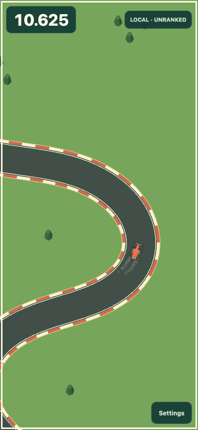
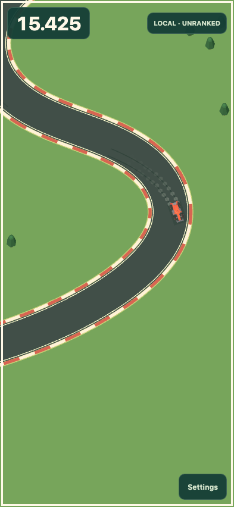
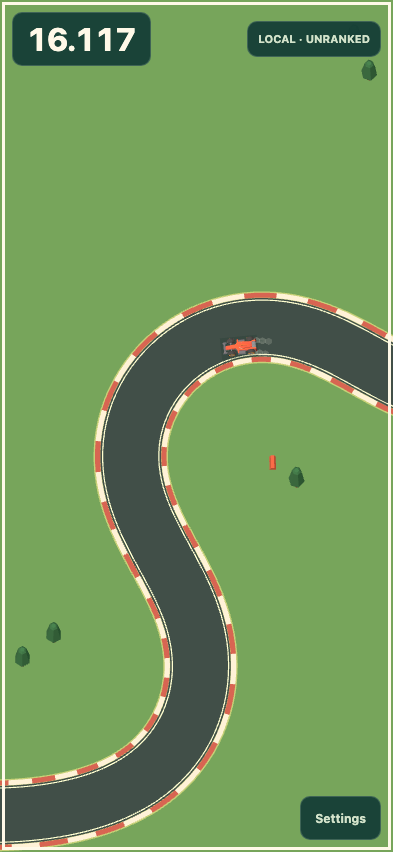

# Repeatable driving evaluation

The offline kit supports measured changes to #25. It contains the gentle reference loop, an independently authored braking reference and 20 full generated courses. The normal game still uses procedural daily circuits and generated practice; these developer fixtures do not replace them or enter the production browser package.

The canonical geometry and literal hashes are frozen under `tests/fixtures/balance/`. Evaluation reads those files rather than regenerating a seed with a potentially changed generator. The generated selection preserves its original candidate identities, expected outcomes, configuration, selection reasons and source-report/CSV digests. The handmade reference was drawn independently and smoothed through the canonical authoring API; it is a controlled comparison, not a production generator output.

## Run a comparison

```sh
npm run balance:check -- --report /tmp/racer-balance-baseline-arcade-v1.json
npm run balance:check -- --compare /tmp/racer-balance-baseline-arcade-v1.json --report /tmp/racer-balance-comparison.json
```

Use a new output path each time. The command refuses existing output, frozen fixture paths and replacement of the comparison input. There is no update-goldens option. Normal `npm run check` runs inexpensive fixture/replay regression checks; the complete 22-course search is an explicit developer command.

The existing bounded search evaluates hold, cautious and improving-fast controls using the shared fixed-step racing rules. All three resulting input tapes must pass authoritative replay verification. The report includes exact ticks/times, meaningful releases, off-road exposure, recoveries and accounted work. It compares only matching canonical courses and supported runtime versions; a future runtime migration needs explicit compatibility support. It does not silently equate different geometry/rules or rewrite expected results. The improving search is not a global optimum, and the cautious controller's rapid input chatter is not a suggested human strategy.

The gentle loop preserves its established hold and deliberate-release reference goldens. Do not label a deliberate-release tape as the result of bounded search. The challenging handmade reference and 20 generated references retain the previously recorded three-controller outcomes. Unpinned control results are labelled explicitly.

## Interpreting the set

The 20 generated cases are a deliberately selected diagnostic subset, including extremes and one reserve request. Their one-of-20 reserve count is coverage, not a population fallback estimate. The separate original 200-request report recorded three reserves (1.5%); keep that denominator and provenance intact.

The current quality policy permits three to eight meaningful releases. The product target of four to eight is a tuning question for human playtests. Tightening the threshold without evidence would reject the current three-release reserve and change daily generation policy. This kit changes neither handling nor policy.

## Decision log

| Decision                                                                  | Evidence and consequence                                                                                                                       |
| ------------------------------------------------------------------------- | ---------------------------------------------------------------------------------------------------------------------------------------------- |
| Keep `fixed-step-v2` / `arcade-v1` at 120 Hz                              | Existing ranked challenges and replay goldens retain identical movement.                                                                       |
| Keep acceleration 6.8, braking 9.5, maximum speed 22 and lateral grip 7.8 | No measured first-time player evidence currently justifies new parameters. The complete handling object remains in `src/shared/simulation.ts`. |
| Freeze full geometry, hashes and reference outcomes                       | A future generator cannot silently change the comparison set.                                                                                  |
| Keep full search outside the default check                                | Everyday checks verify identities and recorded replays without another full generator campaign.                                                |
| Leave human outcomes blank                                                | Bots cannot establish understanding, comfort, learning or enjoyment.                                                                           |

Use [the observation sheet](playtest-observations.md) for the remaining human criteria. Production handling changes require a new supported version and an explicit historical-challenge compatibility plan; never reinterpret an existing day's leaderboard with new rules.

## Recorded baseline

The [explicit Node 22 report](evidence/balance-arcade-v1.json) binds the evaluated scripts, manifest and shared runtime by SHA-256. All 22 courses completed under all three controls, all literal expected ticks matched, and all 25 stored full-state replay snapshots reproduced. Node 24 produced the same driving outcomes. The comparison reported zero metric/release-interval differences.

| Course group                  | Hold time      | Cautious time   | Bounded-fast time | Interpretation                                                                                       |
| ----------------------------- | -------------- | --------------- | ----------------- | ---------------------------------------------------------------------------------------------------- |
| Gentle reference              | 15.558s        | 16.850s         | 13.542s           | Tutorial control, outside daily quality targets; cautious/fast are explicitly unpinned observations. |
| Handmade braking reference    | 33.300s        | 37.108s         | 27.717s           | Four meaningful releases; all three recorded controller outcomes remain pinned.                      |
| 20 selected generated courses | 27.650–38.017s | See full report | 22.550–30.208s    | Three to six meaningful releases and 3.775–8.433s gains over hold on this selected set.              |

Seven selected generated courses have three meaningful releases, seven have four, four have five and two have six. That is a diagnostic subset distribution, not a human difficulty or population estimate. The gentle reference's independent deliberate-release golden is 13.250s, faster than the 13.542s bounded search result; this concrete limitation is retained rather than relabelling the search optimal.

Accounted work was 1,300 controller trajectories / 4,494,781 controller ticks plus 91 replay checks / 330,073 replay ticks. The limits are 1,452 controller runs, 91 replay checks and a combined 22,219,200-tick budget. Completed searches report measured work; replay attempts charge their requested endpoints, and a search that throws before returning is conservatively charged its full bound. Failure accounting is labelled explicitly. No generation occurred during evaluation.

The full repository check passes 307 units, formatting, types, lint, 200 requested tracks and the production build. All 307 units also pass on Node 22. The [rebuilt client/server parity check](evidence/balance-production-parity.json) finds all 21 production files byte-identical to the private 0.0.13 build; the offline kit is absent. A new private upload is unnecessary for this tooling-only change.

## Playing the references

`npm run dev:local` opens the gentle reference at `/game.html`. Existing `/game.html?seed=regression-154`, `regression-197` and `regression-24` selectors preview current generated examples locally. The frozen kit checks their canonical identity against the recorded set; a future generator may require a separate preview adapter rather than assuming seed equality. The handmade comparison is currently an offline canonical/replay fixture, not a new player-facing practice option.

## Local rendered examples

These actual 393×852 / DPR 1 frames use source `75019ab13d2e1d9610de83d2f4061e973cb6ebdc` with unchanged game code, real Kenney assets and ordinary Start/Space input scheduled with a test clock. Before capture, the current Node generator matched each frozen canonical hash. They are current-generator DEV previews, not a promise that future seed reconstruction equals the frozen loader. Page, console and GL error lists were empty. [Capture evidence](evidence/balance-render-2026-11-13.json) records full hashes, native input schedules, renderer and image digests.







These are not physical-phone, first-time human or optimal-run observations. Nothing from the offline bot reports is inserted into a daily leaderboard.
