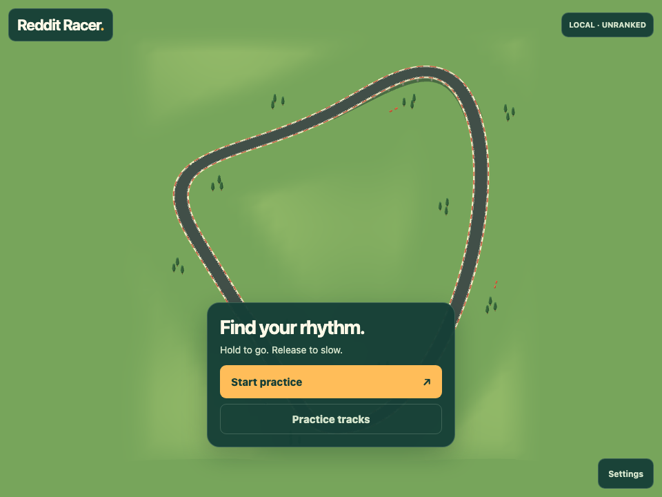
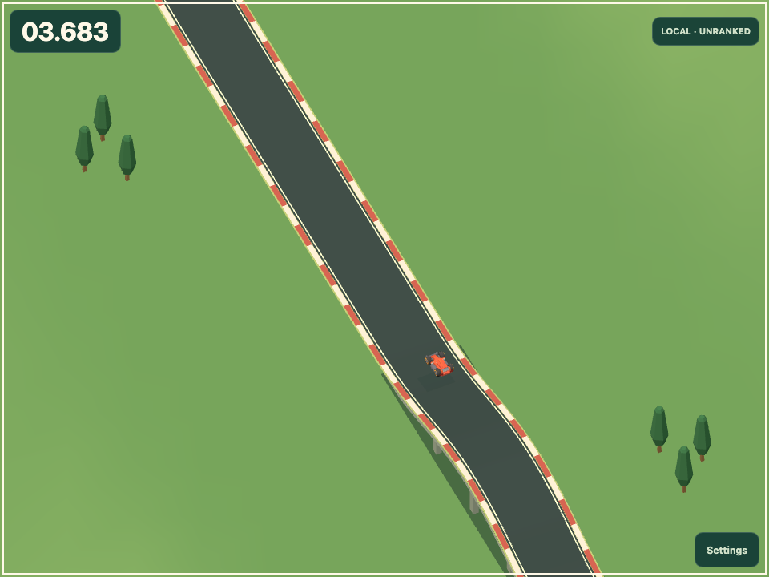
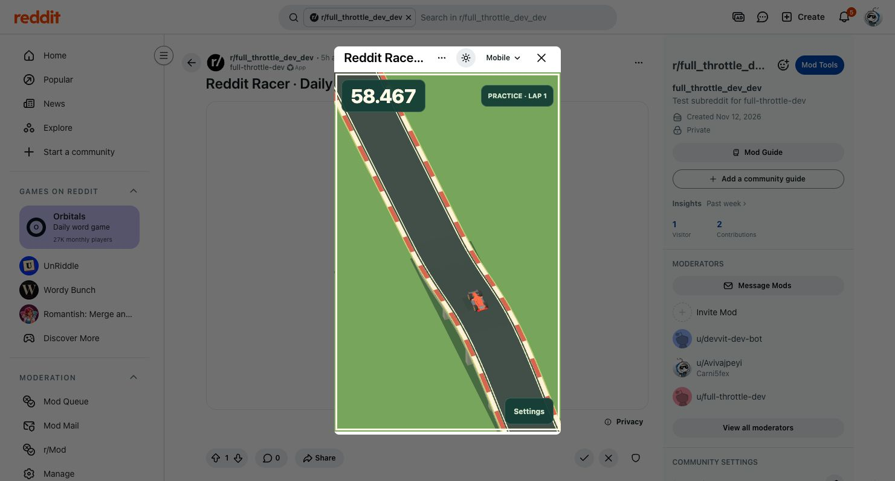

# Elevated circuits and faster driving

Issue [#49](https://github.com/kickflip-games/reddit_racer/issues/49) responds to the request for more interesting maps, verticality, jumps and a livelier car. The racing screen keeps its timer, hold/release control and existing sound palette.

## Playing and inspecting

Choose **Practice tracks** in the game for new unranked elevated circuits. Laps keep flowing without another Start press. **New track** generates another approved layout. Daily courses already stored in Redis retain their geometry, handling and scores; newly created UTC days use the elevated generator. Deploying never replaces an existing day.

Local development:

```sh
npm run dev:local
# Fast single-lap test, with ordinary countdown/retry:
# http://localhost:5173/game.html?elevated=1&seed=flow-probe-21
# Continuous practice:
# http://localhost:5173/game.html?practice=1&seed=flow-probe-21
# Bounded batch preview and selected driving checks:
# http://localhost:5173/track-gallery.html?elevated=1&prefix=elevated-regression&count=100&seed=elevated-regression-0
npm run tracks:check -- --elevated --prefix elevated-regression --report /tmp/elevated-quality.json
```

The original local seed selector without `elevated=1`, classic workshop, frozen balance kit and classic validation cohort remain available for reproducing old daily rules. Developer selectors never override the immutable course received from Reddit.

## Shared road and driving rules

`flow-loop-v2` starts with a seeded point cloud and convex hull, adds inward returns and displaced intermediate controls, fairs the control polygon and samples a closed C2 B-spline. A sufficiently long straight supplies a flat standing start and a safe jumping runout. All corridors still pass the existing intersection, road-edge clearance, radius, seam and playability checks.

Track schema 2 stores every sample's height, grade and vertical curvature alongside its horizontal centreline, width and checkpoints. A compact smooth four-metre crest makes the opening straight a speed-dependent jump; a wider 2.8-metre hill adds a climb and descent later in the lap. Both profiles and their first two derivatives join level road smoothly. Start and finish runouts remain level for continuous flying laps. The complete accepted geometry is hashed and persisted, rather than reconstructed from the seed after deployment.

New courses use the exact pair `fixed-step-v3` / `arcade-v2` at 120 Hz. Acceleration rises from 6.8 to 11.5 m/s² and maximum pace from 22 to 30 m/s, with progressive release braking, slope gravity, useful corner lifts and time-costing off-road recovery. A convex crest can release tyre contact; fixed-tick ballistic flight preserves forward momentum until landing. The first departure step must actually clear the sampled road, avoiding numerical micro-hops. Airborne braking does not act like tyre contact. Off-road ground is level and falling below a raised section triggers the same bounded recovery instead of ending the attempt.

The retained `fixed-step-v2` / `arcade-v1` implementation and schema-1 serialized shape remain unchanged. Session, challenge and replay parsing support only complete matching pairs. A legacy replay cannot be scored on an elevated record, nor can a deployment reinterpret an old day. The frozen elevated fixture records full geometry, its input tape and grounded/airborne/finished states, in addition to the existing 25 frozen legacy replay checks.

Rendering derives asphalt, kerbs, fascia, instanced bridge piers and shadows from that centreline. The steeper camera includes raised road and airborne car bounds. Car pitch, shadows and pooled landing effects follow the simulation; airborne tyres do not paint skids or emit tyre smoke. Terrain stays outside the recoverable driving envelope and scenery sits on its terrain height. Existing Kenney cars and objects remain in use. No new road tile collection or runtime ZIP is shipped. Engine speed is normalized to the new pace while preserving the oscillator/filter recipe; tyre effects require ground contact.

## Work limits and observations

Generation tries at most 32 structural candidates and eight requested quality searches, followed by one explicitly reported procedural reserve assessment. Every quality search still has the existing bounded controller/replay work. Search-budget changes do not alter a candidate's geometry. The elevated cohort fails if more than 5% of courses use the reserve or fewer than 95% have distinct curvature profiles. The reserve is itself revalidated; it is never silently approved.

The committed [200-course observation](evidence/elevated-circuits/validation.json) records all seeds, hashes, selected candidates, work summaries and source hashes. It accepted 200/200, with two reserve uses and 199 distinct profiles/hashes. The fast controller completed in 22.8–29.7 seconds (median 26.25), with three to five meaningful releases; it improved over holding throughout by 1.275–7.075 seconds. These are scripted controls, not first-time-player or physical-phone measurements.

Local checks pass 319 unit cases on Node 24.22.2 and Node 22.23.5, including retained legacy goldens, elevation bounds, gravity, recovery, immutable storage, HTTP session verification and duplicate receipts. Browser checks include real WebGL rendering, native key input, takeoff/landing, continuous practice, and Chromium/Safari replay agreement. The fixed-source full local browser run passes all 134 cases, retaining all 127 earlier identities with no retry, skip or flake. Private `0.0.14`, built from clean source `11bc719`, is installed. [Native observations](evidence/elevated-circuits/private-playtest.json) record the retained daily verification/PB, two practice laps, a different generated course, and actual takeoff/landing. The current UTC daily stays on schema 1; the next new daily receives schema 2. A live elevated ranked day has not been fabricated to replace the immutable current day. CI remains a required merge gate on the final PR head.





These captures use the production renderer and ordinary input with a scripted browser clock. They establish visual rendering, not device FPS or human handling comfort.



The private observation uses Reddit's desktop Mobile preview, not a physical phone. Native lap times include operator idle and are not used to tune pace. Batched immediate post-Start key input did not accelerate; canvas-targeted input after observing the running phase did. The automated start-to-hold tests passed. Four returned outer-page log entries had no game-origin entries; this does not establish comprehensive hosted error capture.

## Reference decisions

The first-hand [Gustavo Maciel article](https://www.gamedeveloper.com/programming/generating-procedural-racetracks) and [Bites of Code implementation notes](https://bitesofcode.wordpress.com/2020/04/09/procedural-racetrack-generation/) informed the hull, displaced-control and smoothing approach. The [Dávid Kerekes interview](https://80.lv/articles/using-houdini-for-large-terrains-006sdf) informed keeping road sweeps, terrain masks and purposeful scenery related. The implementation is original repository code; model tiles do not restrict the generator or define physics. The supplied Kenney elevation image is visual inspiration rather than a requirement to introduce intersections. The supplied OhioLink PDF returned a partial file without a readable trailer; no technical claims here depend on that unread document.

Overpasses, gaps between road pieces, destructible scenery and extra controls are outside this change. The current jumps use a continuous safe road underneath, so slower players can roll over the crest and recover from mistakes. Physical-phone comfort, audible SFX assessment and first-time player balance remain part of the existing open playtesting work.
