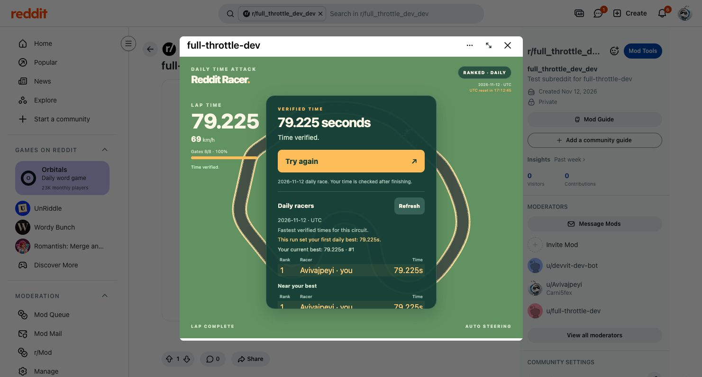
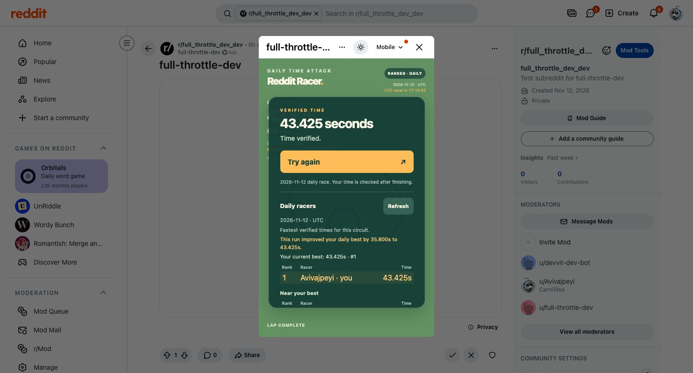

# Private Reddit playtest evidence

## 2026-11-12: authenticated replay and daily standings

- Registered app: `full-throttle-dev`, unchanged.
- Private installation: `r/full_throttle_dev_dev` (`t5_kv7foq`).
- Test post: [1xtz9oc](https://www.reddit.com/r/full_throttle_dev_dev/comments/1xtz9oc/fullthrottledev/).
- Explicit owner-only installed build: `0.0.6`, exact source `93e2d3c5774842c43af383c84aee13f88a4d37af`.
- Account shown by real server standings: `Avivajpeyi`.
- Loaded circuit: 2026-11-12 UTC, eight ordered gates.

The earlier Reddit network-security page cleared on an ordinary reload. Reddit's existing signed-in session redirected normally from its login page. No security challenge, certificate warning or CAPTCHA was bypassed. The post's lightweight teaser loaded, and Play expanded the actual Three.js game inside Reddit.

These checks used normal UI clicks and timed Space holds/releases. There were no injected API calls, mock authentication, altered simulation state or invented standings. The pauses between automation actions are included in race time; these runs test functionality and do not establish optimal times, balance or first-time human enjoyment.

| Check                 | Observed result                                                                                                                                   |
| --------------------- | ------------------------------------------------------------------------------------------------------------------------------------------------- |
| Authenticated start   | Server session preparation changed the game to `RANKED · DAILY`, then countdown started.                                                          |
| First complete lap    | All eight gates; `Time verified`, 79.225 seconds, first daily best and rank 1 under the real account.                                             |
| Full post reload      | Reopened teaser and expanded game; started a new authenticated attempt on the same daily circuit.                                                 |
| Second complete lap   | Server verified 43.425 seconds and reported an improvement of 35.800 seconds. The previous 79.225-second best therefore survived the full reload. |
| Standings refresh     | Reloaded server standings retained 43.425 seconds and rank 1.                                                                                     |
| Immediate Retry       | Returned directly to a fresh countdown with time zero and gates 0/8, reusing the loaded scene.                                                    |
| Slower complete retry | Server verified 62.425 seconds while keeping the daily best at 43.425 seconds.                                                                    |

The first run used the desktop expanded view. The refreshed and slower runs used Reddit's owner mobile device preview, not a physical phone. Retry remained visible. Captured console errors were Reddit's outer `redditstatic.com` Sentry module fetch failures; no game-origin console errors were captured.

The independent private storage diagnostic also passed all seven controls, including real adapter create/improve, conflict rejection, sorted reads, expiry and cleanup. See [the diagnostic report](private-redis-smoke.md). It used separate temporary keys and did not seed player standings.

## 2026-11-12: quick-results UI and moderator post creation

Private `0.0.7` was uploaded and installed from exact source `af6d969d7d8de22e04ce15b670f542d0b53e8e49`. The original private post loaded **Race today** without the earlier sign-in claim. An actual authenticated run completed all eight gates and verified at 49.642 seconds. The compact result correctly showed the retained 43.425-second best, rank 1 and this run's 6.217-second slower delta. Expanding **Daily standings** showed the real account once and no duplicate nearby table. Finish focus moved to the result heading.

From the private community's overflow menu, **Create today's race** created [post 1xu6n05](https://www.reddit.com/r/full_throttle_dev_dev/comments/1xu6n05/reddit_racer_daily_time_attack/) and automatically navigated to its valid Reddit URL. The new teaser included the 2026-11-12 UTC date; Play expanded the saved daily course with **Race today**. This exercised the actual moderator endpoint, canonical URL, post creation, metadata and daily loading. It does not establish an archived-post CTA across midnight.

This source's temporary loading note still said ranked racing was coming soon. The following copy-only correction changes that note to preparing the circuit; it does not change the observed session, score or navigation behavior.

## Remaining checks

- The pre-start `Sign in` / `Start practice` issue observed in `0.0.6` was corrected and checked in `0.0.7`.
- These observations do not cover logged-out private-post access, hosted network-failure/replay-rejection UI or an archived post after UTC rollover. Keep #20 open until those conditions are exercised or their platform restrictions are precisely recorded.
- Physical phone performance, touch comfort and first-time human playtesting remain separate acceptance criteria under #4, #24 and #25.
- No public publishing, app review submission, privacy change or public launch occurred.
