# Private Reddit playtest evidence

## 2026-11-12: authenticated replay and daily standings

- Registered app: `full-throttle-dev`, unchanged.
- Private installation: `r/full_throttle_dev_dev` (`t5_kv7foq`).
- Test post: [1xtz9oc](https://www.reddit.com/r/full_throttle_dev_dev/comments/1xtz9oc/fullthrottledev/).
- Explicit owner-only installed build: `0.0.6`, exact source `93e2d3c5774842c43af383c84aee13f88a4d37af`.
- Account shown by real server standings: `Avivajpeyi`.
- Loaded circuit: 2026-11-12 UTC, eight ordered gates.

The earlier Reddit network-security page cleared on an ordinary reload. Reddit's existing signed-in session redirected normally from its login page. No security challenge, certificate warning or CAPTCHA was bypassed. The post's lightweight teaser loaded, and Play expanded the actual Three.js game inside Reddit.

These checks used normal UI clicks and timed Space holds/releases. There were no injected API calls, mock authentication, altered simulation state or invented standings. The pauses between automation actions are included in race time; these runs test functionality and do not establish optimal times, balance or first-time human enjoyment.

| Check                 | Observed result                                                                                                                                   |
| --------------------- | ------------------------------------------------------------------------------------------------------------------------------------------------- |
| Authenticated start   | Server session preparation changed the game to `RANKED · DAILY`, then countdown started.                                                          |
| First complete lap    | All eight gates; `Time verified`, 79.225 seconds, first daily best and rank 1 under the real account.                                             |
| Full post reload      | Reopened teaser and expanded game; started a new authenticated attempt on the same daily circuit.                                                 |
| Second complete lap   | Server verified 43.425 seconds and reported an improvement of 35.800 seconds. The previous 79.225-second best therefore survived the full reload. |
| Standings refresh     | Reloaded server standings retained 43.425 seconds and rank 1.                                                                                     |
| Immediate Retry       | Returned directly to a fresh countdown with time zero and gates 0/8, reusing the loaded scene.                                                    |
| Slower complete retry | Server verified 62.425 seconds while keeping the daily best at 43.425 seconds.                                                                    |

The first run used the desktop expanded view. The refreshed and slower runs used Reddit's owner mobile device preview, not a physical phone. Retry remained visible. Captured console errors were Reddit's outer `redditstatic.com` Sentry module fetch failures; no game-origin console errors were captured.

The independent private storage diagnostic also passed all seven controls, including real adapter create/improve, conflict rejection, sorted reads, expiry and cleanup. See [the diagnostic report](private-redis-smoke.md). It used separate temporary keys and did not seed player standings.

## 2026-11-12: quick-results UI and moderator post creation

Private `0.0.7` was uploaded and installed from exact source `af6d969d7d8de22e04ce15b670f542d0b53e8e49`. The original private post loaded **Race today** without the earlier sign-in claim. An actual authenticated run completed all eight gates and verified at 49.642 seconds. The compact result correctly showed the retained 43.425-second best, rank 1 and this run's 6.217-second slower delta. Expanding **Daily standings** showed the real account once and no duplicate nearby table. Finish focus moved to the result heading.

From the private community's overflow menu, **Create today's race** created [post 1xu6n05](https://www.reddit.com/r/full_throttle_dev_dev/comments/1xu6n05/reddit_racer_daily_time_attack/) and automatically navigated to its valid Reddit URL. The new teaser included the 2026-11-12 UTC date; Play expanded the saved daily course with **Race today**. This exercised the actual moderator endpoint, canonical URL, post creation, metadata and daily loading. It does not establish an archived-post CTA across midnight.

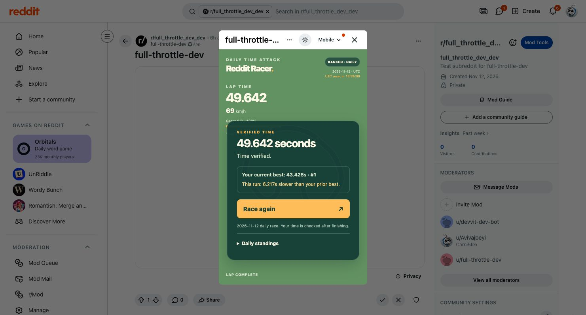

This source's temporary loading note still said ranked racing was coming soon. The following copy-only correction changes that note to preparing the circuit; it does not change the observed session, score or navigation behavior.

## 2026-11-12: Kenney car, generated kerbs and chase camera

Private `0.0.8` was uploaded and explicitly installed from clean source `965374fc61c7fc4180b9bd8f99fc447f6392126e`. Reopening [post 1xu6n05](https://www.reddit.com/r/full_throttle_dev_dev/comments/1xu6n05/reddit_racer_daily_time_attack/) loaded the `0-0-8` expanded-view URL and its original November 12 daily circuit. The lightweight teaser still loaded independently.

Reddit's owner **Mobile** preview showed the real Kenney racer, themed trees/barriers, generated kerbs and compact backed telemetry. Normal Space holds/releases drove the car through the actual daily turns and an off-road excursion while the orthographic camera kept the car and upcoming road visible. The run completed all eight gates and verified at **50.025 seconds**, preserving the **43.425-second personal best / rank 1** and displaying the correct **6.600-second slower** delta. **Race again** immediately returned to countdown, time zero and gates 0/8 on the same loaded course. The extra unfinished attempt was closed without a second score.

No game-origin errors were captured. The captured error list contained the existing outer Reddit Sentry-module fetch failure. UI automation pauses count toward this run; this is functional hosted evidence, not balance, optimal play, physical-phone performance or first-time human feedback. No mocked identity, API response, score, clock or driver state was injected. This upgrade is not a newly observed AppInstall event. No public publication, review submission or community privacy change occurred.

## 2026-11-12: rendering-cost fix

Private `0.0.9` was uploaded and explicitly installed from clean source `f4facce7798caeefcf564729a72b02050f72d8ef`. The same post expanded at its `0-0-9` URL with the original daily course. The matched flat grass field retained the visible Kenney car, road, props and contact shadow in Reddit's owner Mobile preview.

Normal UI Space holds/releases completed all eight gates at a server-verified **46.392 seconds**, keeping the **43.425-second best / rank 1** and the correct **2.967-second slower** delta. **Race again** returned to countdown, time zero and gates 0/8; the extra unfinished attempt was closed without another score. The captured current error list contained only Reddit's outer Sentry-module fetch failure. This is functional hosted regression evidence, not a measurement of phone FPS, audible sound, balance or optimal play. Automation pauses count toward the run.

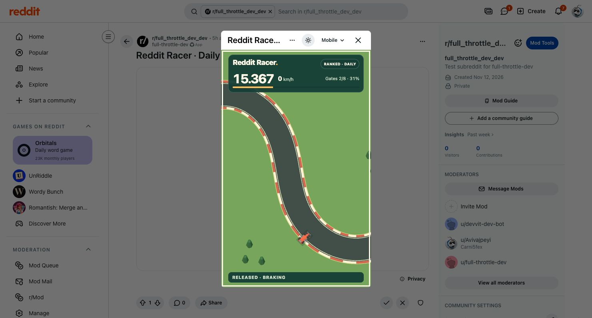

The earlier failed desktop CI run remains recorded in the implementation log. Local checks and this private playtest do not replace the required fresh Linux CI gate. No AppInstall event, anonymous/network-negative/archive case, physical phone or public publication is claimed here.

## 2026-11-12: sound, motion and focus cleanup

Private `0.0.10` was uploaded and explicitly installed from clean source `4e12344d6dcc6e95747a7a7eb5e2f236280e91af`. The original daily post expanded at its `0-0-10` URL with the same immutable November 12 circuit. These observations use normal UI controls in Reddit's owner Mobile preview, not a physical phone.

The native Motion selector changed to Reduced independently of Sound. Mute displayed Sound off; explicit unmute reached the accessible **Sound ready** activation state, and Full motion remained selectable. This establishes browser audio processing, not audible speakers, output routing or silent-mode behavior. No device audio capture was available.

Normal Space holds/releases completed all eight gates at a server-verified **50.408 seconds**, preserving **43.425 seconds / rank 1** and the correct **6.983-second slower** delta. **Race again** immediately reset time/gates to zero and reactivated sound. A short second attempt moved normally. Moving focus from the game to Reddit's preview menu interrupted that attempt, changed it to unranked, and restored the locked sound status; returning alone did not reactivate sound. Another explicit Retry restored ranked countdown and Sound ready. The final unfinished attempt was closed without another score. Settings were restored to Sound on / Motion device.

The address-bar shortcut attempt did not establish a focus transition; the actual preview-menu click supplied the observed focus-loss control. No app-background/OS-interruption or physical-phone result is inferred. Automation pauses count toward the lap; no optimal-time, human-fun or balance claim follows. The captured current error list contained only the existing outer Reddit Sentry-module fetch failure. No mocked authentication, API response, clock, score or driver state was injected; no public publication, install event or community privacy change occurred.

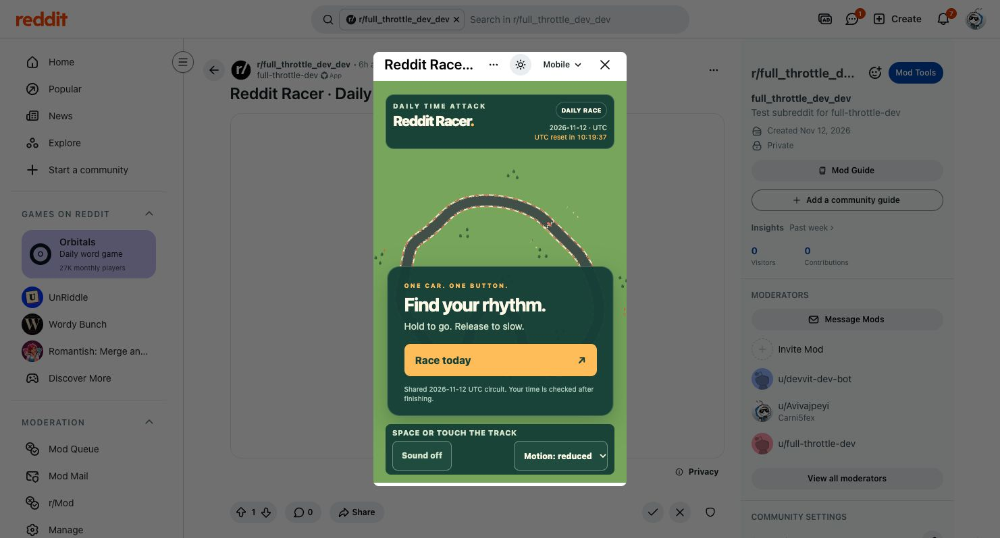

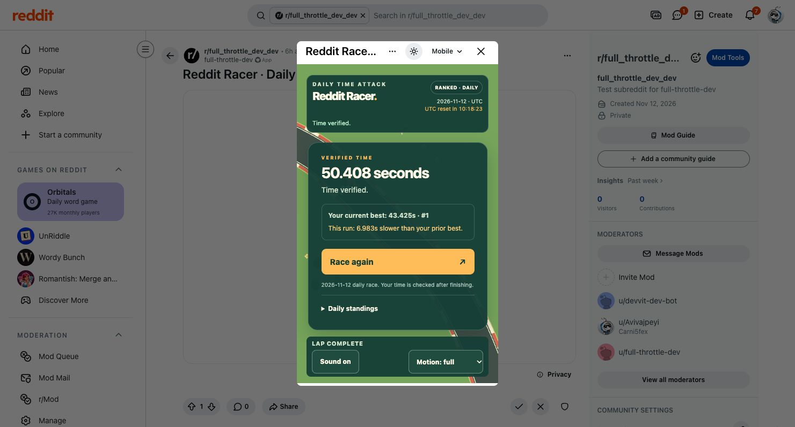

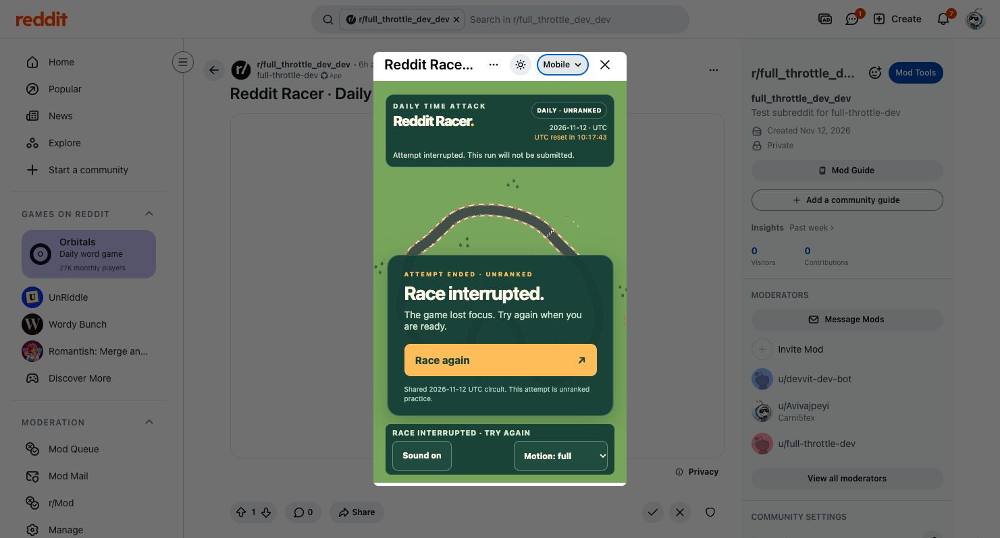

## 2026-11-12: simpler race screen and display handling

Private **`0.0.11`** was uploaded and explicitly installed from clean source **`0284994580243aa1d91e121ae12b608cd9d9b608`**. Reopening [post 1xu6n05](https://www.reddit.com/r/full_throttle_dev_dev/comments/1xu6n05/reddit_racer_daily_time_attack/) confirmed its `0-0-11` expanded-view URL and the same immutable November 12 circuit. These observations use Reddit's owner **Mobile** preview on desktop Chrome, not a physical phone.

The ready screen shows the brief hold/release instruction and **Race today**. Driving shows only the lap clock, a small honest ranked label and collapsed **Settings**. Speed, gate progress and accelerating/braking labels are absent from the painted and accessible race UI. Settings opens independently over the scene; Sound off and Reduced motion work separately. Sound on / Motion device were restored before racing, and Settings closed on Start.

Normal trusted Space holds/releases completed the actual daily circuit with **Time verified**, **43.475 seconds**, the retained **43.425-second personal best / rank 1**, and the correct **0.050-second slower** delta. **Daily standings** remained collapsed on results. Retry prepared a fresh authenticated attempt, reset the visible clock to **00.000** during countdown and kept Settings collapsed. Moving focus into Reddit's parent preview menu safely interrupted the extra attempt without submission. A further explicit Retry returned to ranked countdown at zero; closing the expanded game ended that unfinished attempt. The post was left on its playable teaser.

Captured errors came from Reddit's outer page importing `redditstatic.com` modules; no game-origin errors were captured. No mock identity, request response, score, clock or driver state was injected. UI automation pauses count toward the lap. This establishes functional private deployment and the simplified presentation, not optimal time, balance, audible phone output or physical-phone performance. No public publication, review submission, new AppInstall observation or community privacy change occurred.

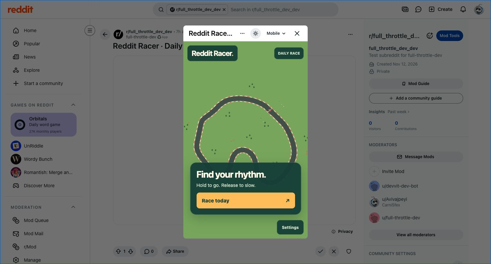

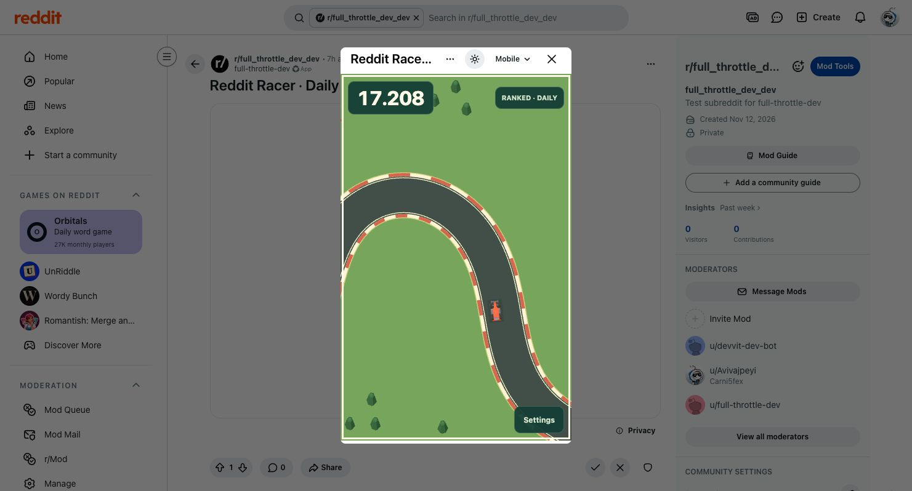

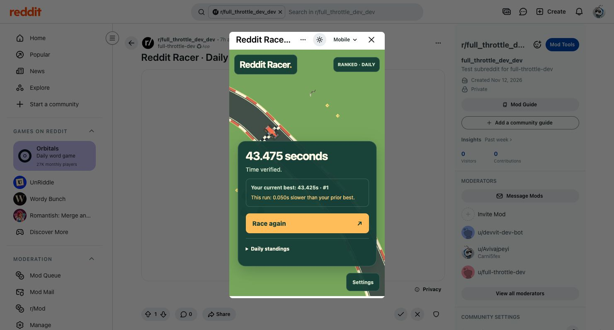

## 2026-11-13: continuous procedural practice

Private **`0.0.12`** was uploaded and explicitly installed from clean source **`1b4d515e5c73443a9a0ce18c10ed705d62fe6b53`**. The first upload required the existing Devvit CLI connection to be refreshed through Reddit's normal authorization page; the retry and install then succeeded. No credentials were added to the repository.

The original [November 12 post](https://www.reddit.com/r/full_throttle_dev_dev/comments/1xu6n05/reddit_racer_daily_time_attack/) expanded at its `0-0-12` URL. It now correctly showed **ARCHIVE · UNRANKED** and retained track SHA-256 `b3cbffa5fc607416d8a7e471aacaeb31eb4d1e08168c2ee4ba7fcd43c65e0e6f`. Its current-day check honestly reported that today's race was not ready; no November 13 post was registered yet. This directly confirms the need for automatic daily availability, without treating an old post as a new challenge.

**Practice tracks** loaded the approved requested seed `practice-79d366eef38fbc0267ce851db1d9a593` with accepted SHA-256 `c3f895278abcd865d3992eab72149f5793ec86f1a0c8fa7ef3f8f74b9b74fc5d`. Native Start and timed Space holds/releases drove through the line into **PRACTICE · LAP 2**, with **Last 41.567** and a running new lap clock. No result prompt, new countdown or leaderboard appeared. Settings exposed the requested seed, Sound/Motion, **New track** and **Daily race**. New track loaded different accepted geometry and returned to ready/lap one. Daily race reloaded the original archived track and its exact SHA, with Settings collapsed and no automatic start. Closing the expanded view left the post ready on its teaser.

These are actual Reddit owner Mobile-preview observations on desktop Chrome. The pauses between native actions count toward 41.567 seconds; it is not an optimal-time, balance, physical-phone performance or human-enjoyment measurement. Automated browser checks separately require two uninterrupted rendered laps and zero practice API calls. Captured current errors were outer Reddit module-import failures; none came from the game origin. No identity, API response, score, clock or driver state was injected. No public publication, app review, privacy change or new AppInstall event is claimed.

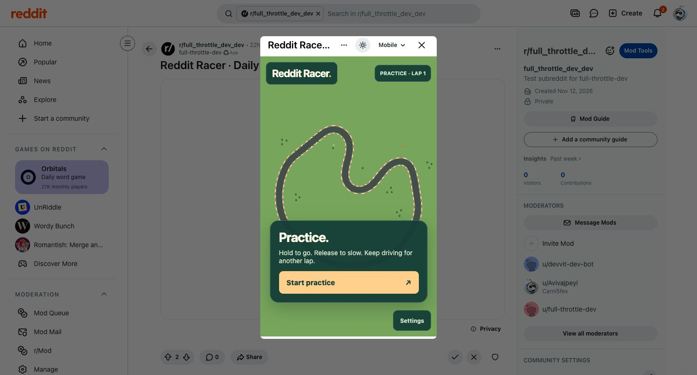

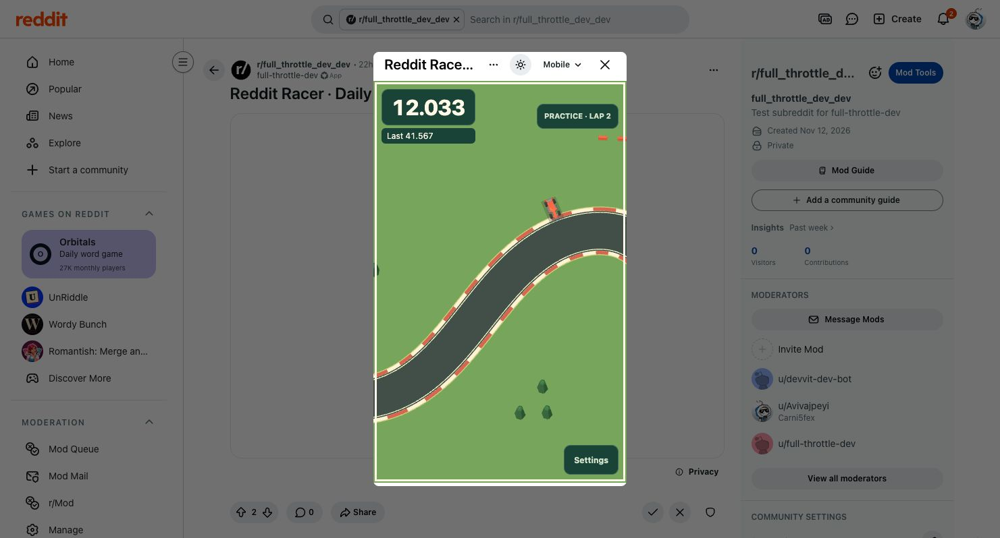

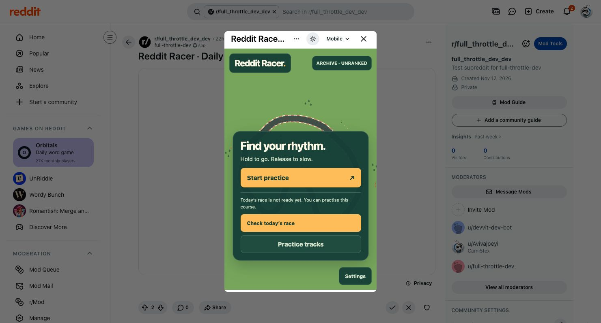

## 2026-11-13: automatic daily race and separate standings

Private **`0.0.13`** was uploaded and explicitly installed from clean source **`d40ffe7a78e3d257d6e7cdd33921f254d134e9c9`**. Upgrade bootstrap logged **ready** at **06:24:48.234 UTC** for the new November 13 [post 1xv0icy](https://www.reddit.com/r/full_throttle_dev_dev/comments/1xv0icy/reddit_racer_daily_time_attack/). Genuine platform scheduler deliveries at **06:25:12.613** and **06:30:08.522 UTC** both logged ready with the same post ID. No manual post-creation action, direct internal task request or clock override supplied these observations. The status-only [runtime evidence](evidence/daily-availability-private.json) records the exact source/version and events.

The original November 12 post expanded at `0-0-13`, remained **ARCHIVE · UNRANKED**, and retained track SHA-256 `b3cbffa5fc607416d8a7e471aacaeb31eb4d1e08168c2ee4ba7fcd43c65e0e6f` and challenge hash `e163f67f7fa51fa764ed1ffa47c024fe6d003328b6a5769aaa71e068f544bddd`. Its current-race action reported November 13 ready. Native Start and Space holds/releases completed archive practice at **50.558 seconds**, with no ranked submission. Its actual November 12 board showed the existing **28.167-second best / rank 1** for Avivajpeyi. That value is the observed current historical best, not the older 43.425-second value from earlier evidence.

**Open today's race** navigated through the supported Reddit client to the actual new post `t3_1xv0icy`. Its lightweight teaser showed November 13, and the expanded **DAILY RACE** loaded challenge `t5_kv7foq:2026-11-13`, track hash `c1e833d6ba03cf9f0892522ff8b29c79a4ed3c5fb2100dc741d366ac34ca177b` and challenge hash `5623b6659e89f6af84aa339d959753bd4e673a0844cbbf49f79d5d6a414de8b2`. Native Race today and Space holds/releases completed a **46.200-second** run. The server returned **Time verified**, **first verified daily best**, and **rank 1**. Opening and refreshing Daily standings showed November 13 UTC, Avivajpeyi and 46.200 seconds, separately from the November 12 board.

**Race again** prepared a fresh ranked countdown, reset the visible clock to **00.000**, preserved today's exact track hash and kept Settings collapsed. Closing the expanded view ended this unfinished retry without a score and left the new post on its playable teaser. Captured errors were the existing outer Reddit `redditstatic.com` module failures; none came from the game origin.

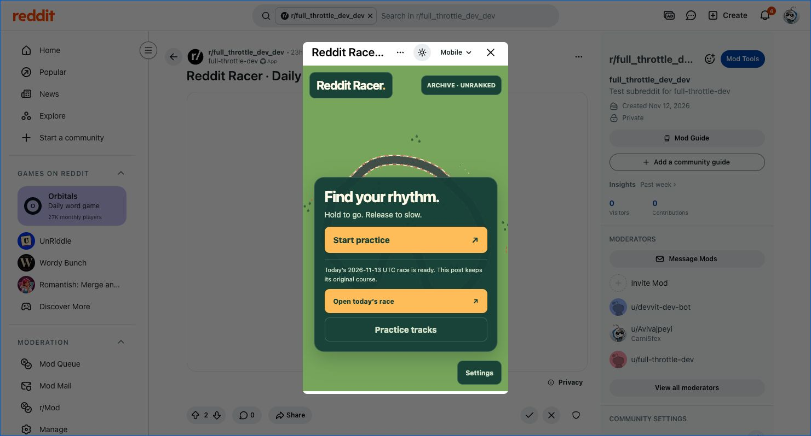

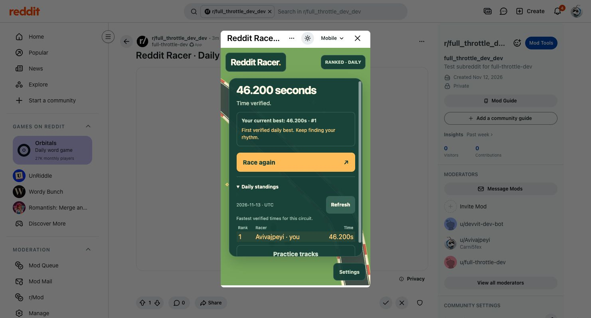

These observations use Reddit owner Mobile preview on desktop Chrome. Native-action pauses count toward the lap times; they are functional evidence, not optimal driving, human balance, physical-phone performance or audible-output measurements. This is a real upgrade and two genuine scheduled callbacks after installation, not an observed future midnight or fresh AppInstall. Unit tests separately cover UTC crossings, malformed callbacks, concurrent claims, lost replies and known-ID repair. No fake identity, replay, response, score, simulation state or clock was injected. No public publication, app review or community privacy change occurred.

## Acceptance matrix and current constraints

The current observed private build is `0.0.13`; its source and observations are recorded above. All three observed posts remain in `r/full_throttle_dev_dev`. The matrix distinguishes actual Reddit observations from automated tests and unsuccessful test attempts.

| Acceptance condition                                     | Evidence or current constraint                                                                                                                                                                                                                             | Next action                                                                                                                                                                                                                                     |
| -------------------------------------------------------- | ---------------------------------------------------------------------------------------------------------------------------------------------------------------------------------------------------------------------------------------------------------- | ----------------------------------------------------------------------------------------------------------------------------------------------------------------------------------------------------------------------------------------------- |
| A real test post renders the game                        | Observed in `0.0.6` through `0.0.13`, including the automatically created [November 13 post](https://www.reddit.com/r/full_throttle_dev_dev/comments/1xv0icy/reddit_racer_daily_time_attack/).                                                             | Preserve the private setup and record a new source/version for later changes.                                                                                                                                                                   |
| Authenticated verification and persistence after refresh | Observed in `0.0.6`: the 43.425-second best survived reload and a slower retry. The `0.0.7` through `0.0.11` results also retained that best.                                                                                                              | No replacement mock evidence is needed for this completed condition.                                                                                                                                                                            |
| Logged-out player can practise inside Reddit             | Not exercised. A logged-out browser cannot enter the current private community; that gate does not test the game's anonymous-practice path.                                                                                                                | Use an authorized signed-out-accessible test surface or a supported Reddit private anonymous-preview capability. Do not change privacy or publish the app to obtain this evidence.                                                              |
| Hosted network-error handling                            | Inconclusive. The offline setting affected Reddit's outer tab but did not reach the separately running game frame. Attaching network controls to that child frame was unsupported. Native browser controls could not be operated while the Mac was locked. | Unlock the Mac and use ordinary browser controls that affect the game frame, or use supported frame-level network control. Observe the game's unavailable/unverified state, restore connectivity and confirm the stored best remains unchanged. |
| Hosted invalid-replay rejection                          | Not exercised. Unit and HTTP tests cover rejection; that is separate from a real hosted negative test.                                                                                                                                                     | With the real authenticated private-post context, send an intentionally invalid replay through the supported transport and confirm rejection with no personal-best change. Do not inject identity, a test clock or a direct score.              |
| Old-post practice and next-day navigation                | Observed in `0.0.13`: the original November 12 circuit/hash and historical board remain; archive practice is unranked, and Open today’s race reaches the actual new November 13 post and separate verified standings.                                      | Completed for the actual November 12→13 archive/current-post path. Future real midnight remains an observation limit; unit rollover checks are separate.                                                                                        |
| Exact setup and install error semantics                  | Private commands are documented in the README. The install route validates the event before creation and uses fixed safe failures; actual mounted-route tests cover those paths.                                                                           | Keep hosted observations distinct from injected creation tests.                                                                                                                                                                                 |

Reddit's [private-community policy](https://support.reddithelp.com/hc/en-us/articles/360060416112-What-are-public-restricted-private-and-premium-only-communities) limits viewing to moderator-approved members. The official [playtest guide](https://developers.reddit.com/docs/guides/tools/playtest) describes generated playtest communities as private. The game's automated anonymous-practice checks do not remove that platform access restriction.

The existing post-created fallback remains important: once Reddit submission succeeds, later binding, postData repair or current-post registration failure returns the created post with a fixed warning only if a trusted read confirms that it is still available in this community on the current UTC day. It does not falsely report that nothing was created. Opening the post retries trusted binding and current-post registration; it does not repeat the SDK postData update. The new install guard handles malformed/wrong event bodies before any creation and reports an SDK creation rejection as a fixed server failure without copying SDK details into the response or log. These changes do not add a test identity, time override or public endpoint.

Keep #20 open while the hosted anonymous/error conditions above remain unexercised or constrained. The archive/current-post condition is now observed. Private daily posts use one shared upgrade/install/menu/scheduler coordinator; no duplicate runtime schedule is registered. Physical-phone performance, touch comfort and first-time human playtesting remain separate criteria under #4, #24 and #25. No public publishing, app review submission, privacy change or public launch occurred.
