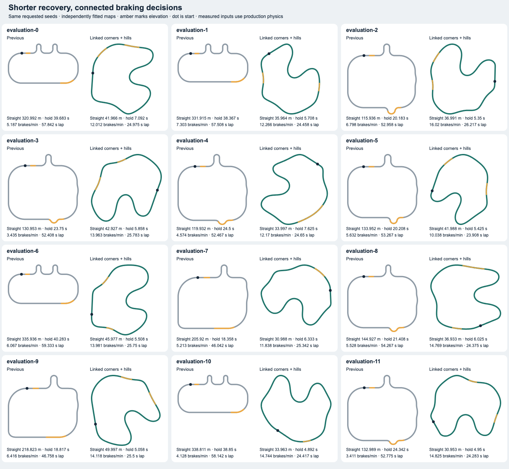
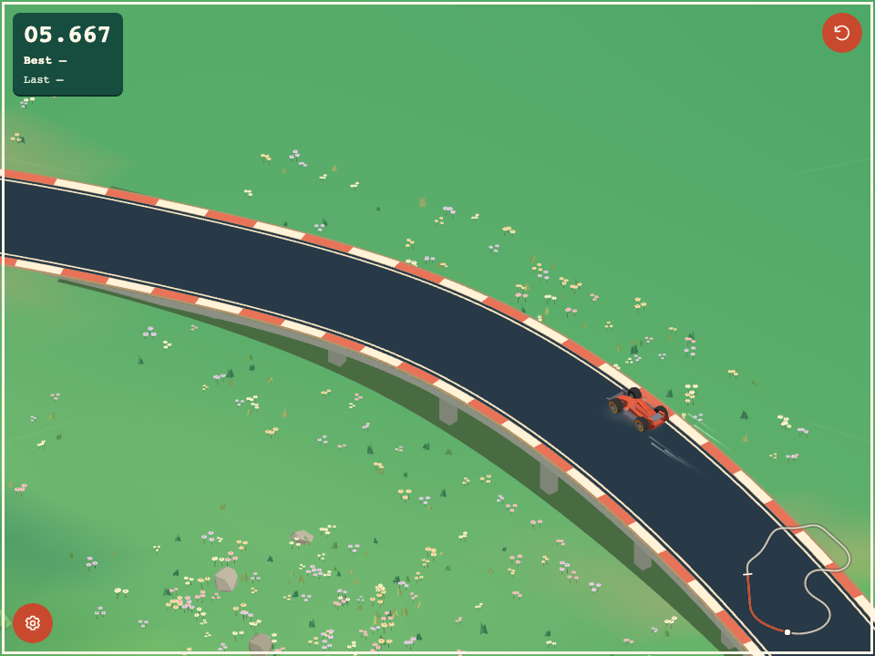
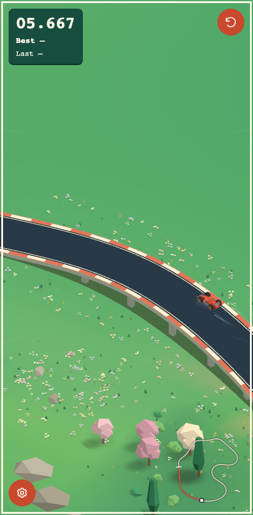

# Linked corners with rolling elevation

New daily races and ordinary practice use `linked-circuits-v1`. The previous
rectangle composed interesting motifs on only one or two sides, then padded the
opposite sides and closed them with very broad sweepers. This left long stretches
where the one-button driver had no useful speed choice.

The new recipe builds on the earlier periodic motif-loop geometry. Six or seven
shuffled sectors combine a single infield return, two or three stronger S-bends,
a tightening corner, a sweeper and a short recovery straight. It removes the
second straight and extra gentle sweepers, rather than adding more hairpins.
The complete spline closes smoothly; rotation, direction, aspect and dimensions
vary deterministically. Courses are 540–600 metres, with the same seven-metre
road width and existing radius, shoulder and nonlocal corridor checks.

One or two compact, smooth hills occupy the longest gentle sections, away from
the start seam and tight braking corners. Height scales with available approach
length, up to five metres. The supported road continues underneath the car.
Hill selection is part of deterministic generation, and final simulation still
rejects airborne tight corners, unsafe landings or a fastest tape requiring
rescue. Tall hills placed indiscriminately over tight corners were rejected in
development because sliding off a raised road can produce an unfair landing.

## Measured driving rhythm

The [saved report](evidence/linked-courses/report.json) includes 100 development
word seeds, 100 additional consecutive UTC daily seeds, banana/tui/river, the
offline reference and the daily reserve. All **205** passed without substitution;
all 205 hashes and signed curvature profiles were distinct. The first 12 seeds
were also generated with the previous v3 acceptance policy for a paired comparison.

| Paired mean, same 12 requested seeds             | Previous v3 | Linked courses |
| ------------------------------------------------ | ----------: | -------------: |
| Longest geometric straight                       |     210.9 m |         38.6 m |
| Longest interval without a sustained brake input |      27.4 s |          5.8 s |
| Meaningful brakes per minute                     |         5.3 |           13.4 |
| Searched braking advantage over holding          |      2.02 s |         5.69 s |

Across the complete 205-course population, searched laps took 23.60–26.74 seconds
with 4–8 meaningful releases, 2.21–8.70 seconds gained over holding, no rescue and
no airborne tight-corner ticks. Longest straights were 28.95–54.91 metres; the
longest interval without a sustained brake was 3.42–7.99 seconds. Continuous
practice reproduced the authoritative searched finish tick on all 12 paired
courses. These are bounded automated driving results, not a global optimum or
a claim of human playtesting.



Each map is independently fitted to its panel. Amber marks elevation and a dot
marks the start. Appearance is supporting evidence; the acceptance gates use
the actual driving model and replay inputs.

## Acceptance and compatibility

The `linked-quality-v1` policy retains structural clearance, smoothness, replay,
completion, off-road and landing checks. It additionally requires a straight no
longer than 65 metres, at least one metre of elevation, at least three meaningful
brakes, and no more than eight seconds without a sustained brake. A release
shorter than 12 ticks (0.1 seconds) cannot reset that last measure. The quality
checks run again on copied canonical geometry when creating a daily record.

Generation is bounded by 24 geometry candidates and eight full driving-quality
assessments. Invalid geometry and absent hill space are rejected before running
controllers. The campaign needed at most 19 candidates and seven assessments.
Failures remain explicit; the daily service can use its separately validated
current-generator reserve and records that fact. Named practice never quietly
substitutes another word's course.

Existing daily records keep their stored road, hash and scored-runtime tuple.
No active daily record is regenerated, migrated or overwritten. The new version
uses the existing `fixed-step-v6` / `progressive-slip-v1` physics. Frozen v1 and
v3 geometry hashes still pass. Plain words select the current generator, as they
already did, and ghosts remain keyed by the actual track hash.

## Browser and integration evidence

The browser tests drive banana, tui and river with real Space key transitions,
advance every rendered frame and verify the exact authoritative lap time in
continuous practice on desktop and Pixel 7-sized Chromium. Hill captures are
taken at a progress point derived from the production replay, without injecting
car or camera poses. Production loading also exercises the built Other tracks
button, invalid-word recovery and reproducible word hashes on both viewports.




The mobile card fix from PR #74 is included in the branch's base. Four additional
desktop/mobile checks passed with both changes together: interrupted-card layout
at compact sizes and a complete banana lap. The built production loading checks
also passed again on the combined result.

Validation passed: formatting, TypeScript, lint, all 437 unit tests, the existing
200-course track check, the 205-course rhythm campaign, six complete desktop/mobile
course browser tests, four combined UI/course checks, and two production loading
checks. CI now runs the rhythm campaign and saves its inspectable report/gallery.
This evidence is local. It does not establish a hosted Reddit deployment or phone
hardware frame rate.

Reproduce the population and gallery with:

```sh
npm run courses:check -- /tmp/racer-linked-courses
npm run test:unit
npm run test:e2e -- tests/browser/linked-courses.spec.ts --workers=2
npm run test:production -- --workers=1
```

## Separate presentation ideas

[Mini Racer's community](https://www.reddit.com/r/MiniRacerGame/) provides useful
examples of named tracks and easy-to-share time challenges. Clear daily race
links, medal targets and recent-day replay navigation are separate presentation
ideas to consider later. Its steering-based cornering should not determine our
braking geometry. No presentation or control changes are included here.
