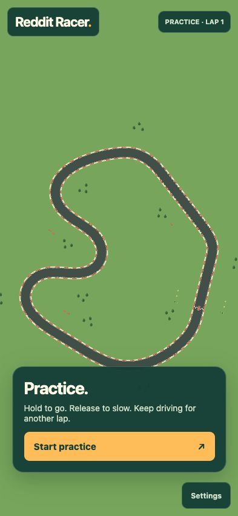
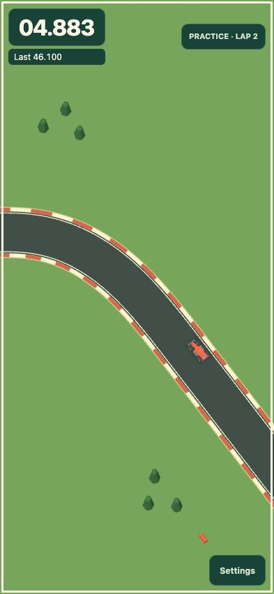
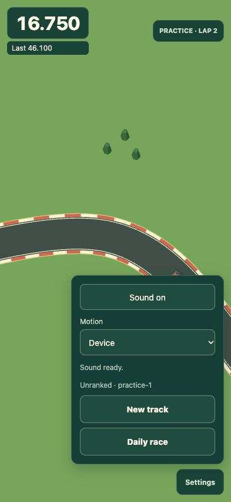

# Continuous practice

Choose **Practice** on the ready/results card. **Start** begins one countdown; crossing the line keeps driving on the same generated circuit. The clock resets for the next lap. Best and Last times remain visible before starting, while driving and when interrupted, with a dash until a time is available. Holding, speed, corner momentum, jump flight, wheel motion and effects continue across the line. Practice has no leaderboard; the best lap persists locally per course and handling version, while Last shows the most recent completed lap of the current run.

Open **Settings** for **New track**, **Daily race**, Sound, Motion and the requested seed. A new track stops the old session and waits for another explicit start. Returning to Daily reloads that post's saved course. Focus loss, a long frame gap or an unusable viewport interrupts practice and releases input; returning alone never resumes it.

For a reproducible standalone course:

```text
http://localhost:5173/game.html?practice=1&seed=practice-1
```

This selector is available only in development. Production practice is entered through the UI; URL seeds cannot replace a Reddit post's daily challenge.

## Generation and identity

Practice lazily imports the existing bounded quality generator when selecting a course. It keeps its structural clearance, driveability, braking-pattern and replay checks, with the documented validated reserve if normal attempts fail. New track tries at most three requested seeds to avoid the previous accepted track hash. Explicit local seeds can reproduce the same course. No handmade track catalogue replaces generation.

This intentionally adds the quality/controller search code to a separate production practice chunk. Its locally computed test trajectories are discarded; the game retains only the accepted track, requested seed, reserve flag and identity. No stored daily audit or precomputed daily input tape is fetched. Practice and ranked use the same canonical gaps/overpasses and centreline runtime. Generation happens while the old scene is stopped, never per frame or accelerator press; physical-phone generation latency remains unmeasured.

Secure contexts use the normal canonical SHA-256 track hash. A phone opening the local server over ordinary LAN HTTP can lack Web Crypto hashing; practice then uses a deterministic `practice-` fingerprint for local course identity and duplicate avoidance. That fingerprint has no ranked authority. Missing random capabilities also have a local seed fallback.

## Driving and ownership

`practice-driver.ts` reuses `stepSimulation` for all movement. It owns continuous lap bookkeeping separately from the one-lap ranked lifecycle. The private physics clock is renormalized at its duration bound while retaining every physical field; presentation ticks and distance stay monotonic. At the line it retains the single tick's overshoot instead of dropping travel. Practice produces no replay or ranked request. Ranked starts still use fresh stationary conditions and the existing one-lap driver.

Each mounted scene owns its asset cache, audio, renderer, effects, observers, frame callback and abortable native listeners. Track/mode changes dispose that scene and daily controllers before mounting a replacement. Late loads are ignored/disposed, daily clocks stop, and old responses cannot repaint the replacement. Settings persist independently of a scene. Repeated practice laps reuse the mounted scene and its fixed visual pools.

Unit tests cover shared first-lap physics, 30/60/120 Hz schedules, retained seam motion/input/recovery, release, checkpoint bookkeeping, interruption/retry and practice beyond the ranked duration limit. Course tests cover deterministic approved seeds, bounded avoidance, result-field exclusion and HTTP/capability fallbacks. Browser tests use actual controls and rendered laps; local and hosted observations remain distinct from physical-phone performance or human enjoyment.

## Historical local visual observation

Native Chrome controls at 393×852 drove `practice-1` across the line into lap two, with the same mounted scene and no result prompt. Last showed 46.100 seconds; UI automation pauses are included, so this is a functional observation rather than a balance/optimal-time result. New track selected a different accepted hash, reset the display to lap one/ready, and focused its title. Settings, Sound/Motion and both track actions were visible. No browser errors were captured. The temporary viewport was restored afterwards.






