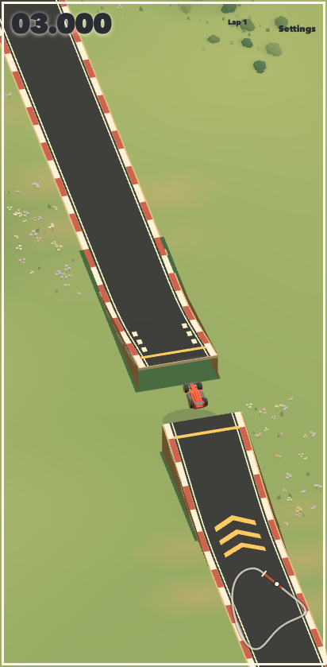
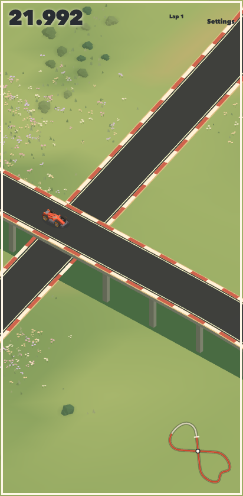
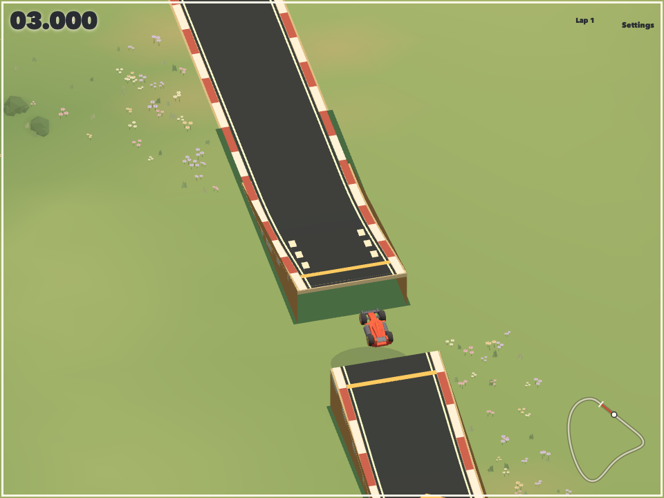
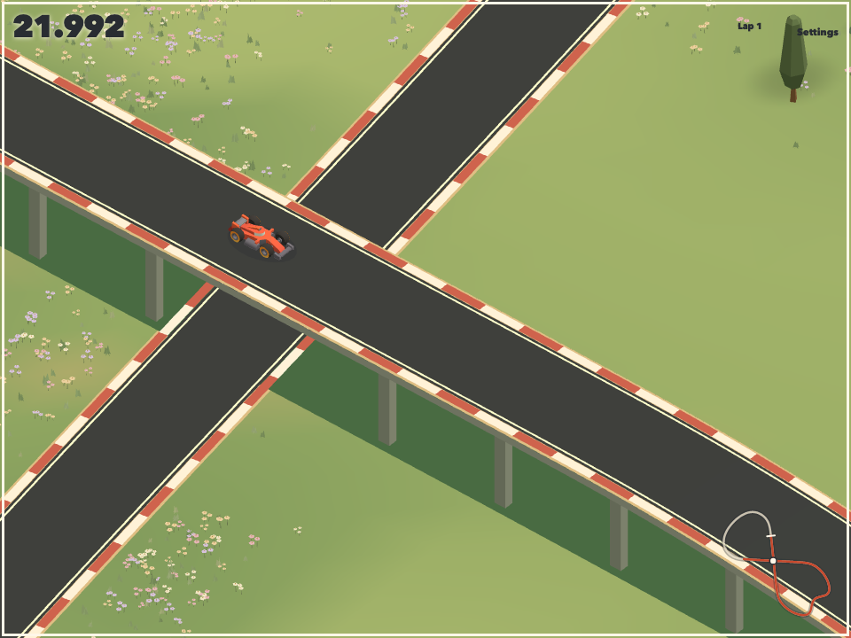
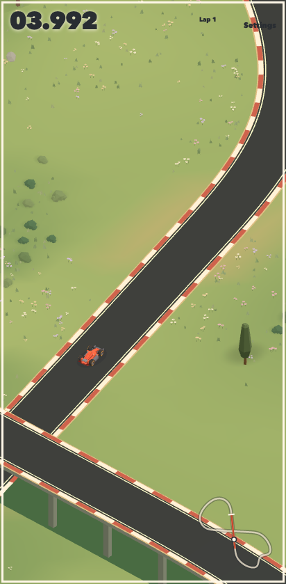
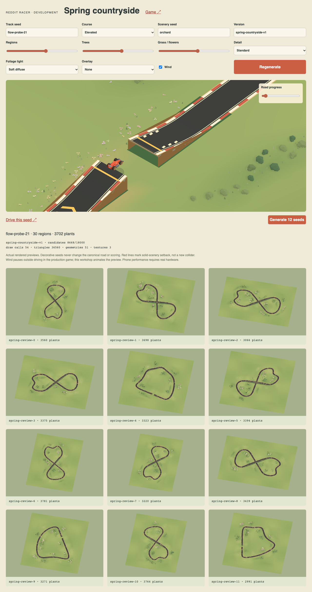

# Predictable countryside routes

The main game has one acceleration/braking mechanic and one countryside style. The camera translates with the car from a fixed, oblique world orientation; it never turns with the road. Portrait framing brings the car closer while retaining the lookahead and safe-area bounds. There is no Lift warning, surface-specific grip, wet/dust asphalt, or separate Slot car/Stunts choice.

The car follows the canonical centreline. A bend's safe pace depends on curvature with the same grip everywhere. Sustained overspeed for 12 fixed ticks loses 40% of forward speed and suppresses acceleration for 72 ticks; timely braking avoids that loss. The car continues along its route throughout. Short tyre scrub and existing sound/lean effects provide feedback without moving the car sideways or adding a warning panel. The thresholds are initial game tuning, not a human-tested balance claim.

## Main course features

`countryside-circuits-v1` deterministically composes two route families with seeded shape, scale and rotation through the existing bounded generator/quality pipeline:

- Countryside loops retain straights, hairpins, S-bends and sweepers, with a canonical opening ramp/gap/landing and a later hill.
- Crossing circuits combine long diagonals, opposing loops and a switchback. The later pass rises onto a six-metre bridge with smooth approach/departure ramps; the earlier pass stays at ground level.

These are ordinary daily/practice courses. A course need not contain every feature. Both families retain the spring scenery regions, palette, ground variation, instanced vegetation and reduced-motion controls.

Track schema 2 now stores jump bounds alongside sample height/grade/vertical curvature. Rendering cuts the same gap used by authoritative simulation. Forward momentum and gravity govern flight; releasing in mid-air cannot apply tyre braking. A missed gap rescues to the landing with a 90-tick stationary cost. Bridge physics follows progress along the stored spline, so the car cannot select the wrong deck by proximity to an overlapping X/Z position.

Structural validation rejects same-level crossings and requires at least 3.5 metres between the complete endpoint height intervals of nearby road segments before allowing an overlap. Bridge fascia follows the road and supports are omitted where they would intersect the lower route. Jump cutaways, launch arrows and landing markings share the normal asphalt/kerbs. The main road uses one material and has no friction zones.

## Rendered views

The following are real browser renders using the ordinary UI and native held Space input with a scripted browser clock. No car, camera or simulation pose is injected. The images show different course sections; they are not matched pixel/performance comparisons. Earlier rotating-camera views are retained in the [previous build evidence](circuit-minimap.md).

| Gap jump                                                                         | Upper crossing                                                                             |
| -------------------------------------------------------------------------------- | ------------------------------------------------------------------------------------------ |
|  |  |

The development workshop also renders twelve seeded compositions with its static review camera:

## Verification and release boundary

The current runtime is `fixed-step-v4` / `centreline-v1`, still at 120 Hz with Boolean input and server replay verification. Canonical jump bounds participate in serialization and hashing. The 356 unit tests include new cases covering overpass headroom, rejection of low crossings, both bridge levels, constant lateral position, gap transport/hash tampering, missed-gap recovery, braking benefit and fixed camera orientation. The stored elevated replay fixture has been regenerated for these rules and pins grounded, airborne and finish states. Browser coverage exercises actual jumps, both crossing levels, native input, responsive minimaps and flowing practice laps; retired mode tests are replaced by the unified-course cases.

This is an intentional pre-release rules reset. The `racer:centreline-v1` storage namespace starts fresh daily geometry, sessions, standings and bests. Old Redis keys are not deleted and no old times are imported into the new competition. The publication journal and post pointers share this revision so the upgraded test build can create a healthy current-day post. No legacy-runtime migration is attempted.

The [200-course report](evidence/predictable-routes/quality.json) records actual acceptance, distinct hashes/profiles, fallback rate, family counts, release opportunities and hold/cautious/heuristic-fast results. These are deterministic controller checks, not optimal times, physical-phone performance or human enjoyment measurements. Physical-device comfort remains a playtest task.

Validation covers 356 unit tests, 200 classic plus 200 main courses, and 160 desktop/mobile/WebKit browser identities. Final complete-run and hosted-CI results are recorded in [PR #63](https://github.com/kickflip-games/reddit_racer/pull/63).
